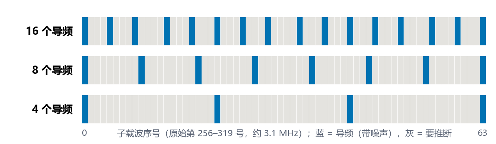
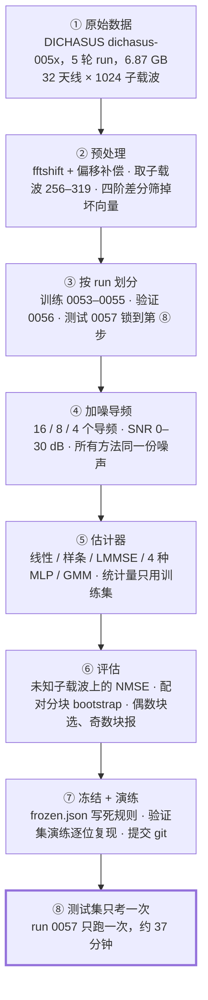
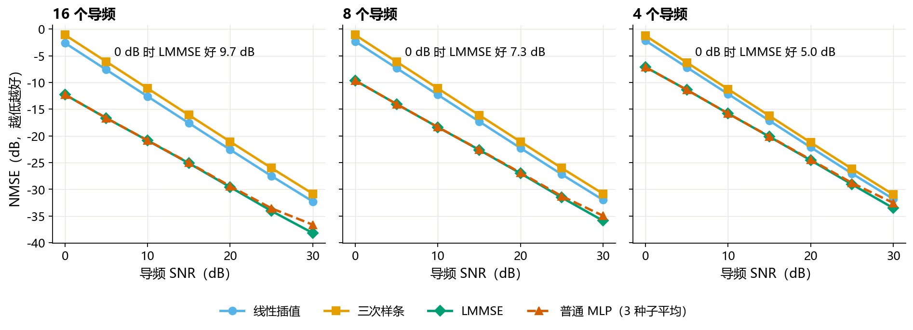
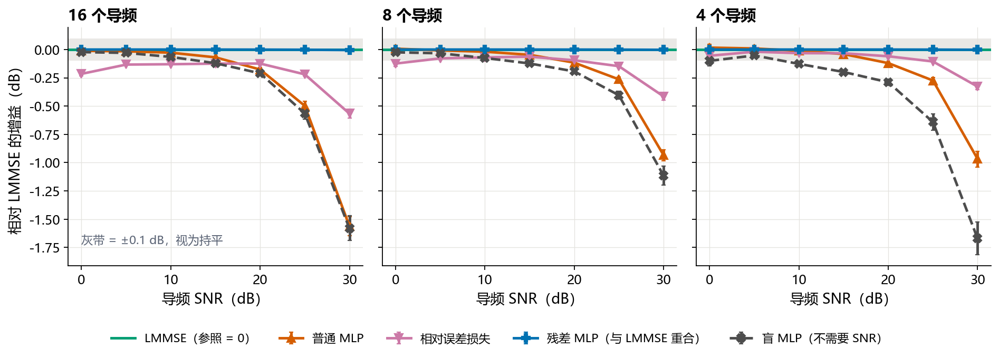
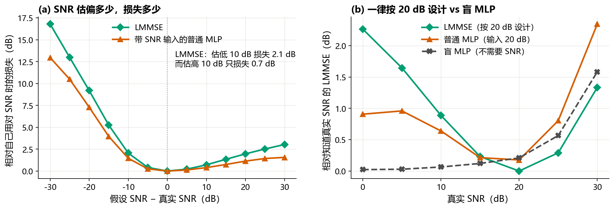
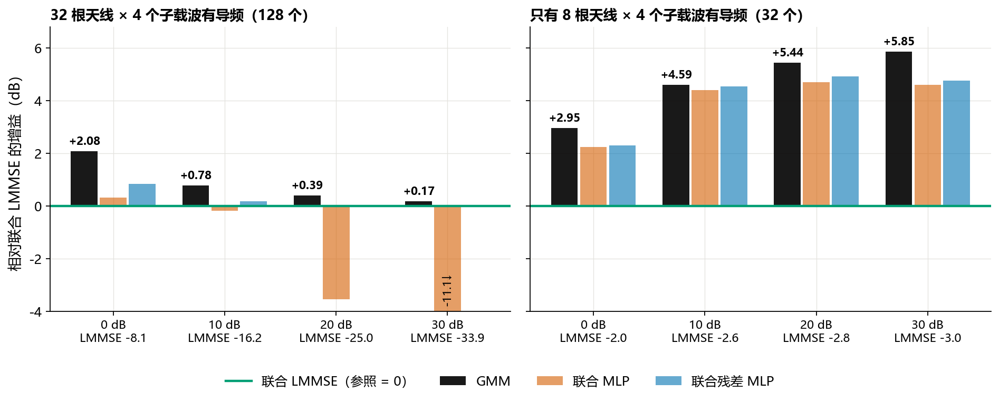

# MCE5901 课程项目白皮书

> 最后更新：2026-11-27 · MCE5901 第 12 组。文中测试结果全部来自测试集 run 0057 上唯一一次评估的记录 `results/20261126-2240_auto_test-0057/run.json`；图由 [`docs/whitepaper_fig/make_figures.py`](whitepaper_fig/make_figures.py) 从该记录生成。

## 0. 一页速览

**核心结论：在真实测量的室内信道上，只在频率方向重建时，神经网络（MLP）没有赢过经典的 LMMSE 估计器；把 32 根天线和子载波放在一起联合重建时，基于高斯混合模型（GMM）的学习型估计器比 LMMSE 好 2.9–5.9 dB。**

**项目题目：** OFDM Channel Reconstruction from Sparse Noisy Pilots Using Measured CSI（基于实测信道数据，从稀疏、带噪声的导频重建 OFDM 信道）。

**课程：** 港中深 MCE5901《机器学习与智能通信》，第 12 组。课程项目占总成绩 15%（汇报 50% + 5 页报告 50%），课堂汇报在 2026-12-18。

**一句话讲清楚在做什么：** 手机和基站通信时，接收端只在少数频率上"抽查"信道（这些频率叫导频），其余频率上的信道要靠猜。我们用德国斯图加特大学公开的真实测量信道数据 DICHASUS，比较几种"猜"法谁猜得最准：线性插值、三次样条、LMMSE、MLP 神经网络，以及扩展部分的 GMM。

**我们问的问题：** 在什么条件下，学习型估计器能比 LMMSE 好？变化的条件有四个：导频的信噪比（0–30 dB）、导频的数量（64 个子载波里放 16、8 或 4 个）、接收端是否知道噪声大小、重建的维度（只看频率，还是天线和频率一起看）。

**关键数字（全部来自测试集 run 0057 上唯一的一次评估）：**

| 问题 | 结果 |
| --- | --- |
| LMMSE 比线性插值好多少？ | 好 1.7–9.7 dB；导频越多、SNR 越低，优势越大 |
| MLP 能否超过 LMMSE（64 个子载波）？ | 不能。84 个设置里没有一个"更好"；35 个更差，49 个在 ±0.1 dB 内持平 |
| 接收端把 SNR 估错了会怎样？ | 估低 10 dB 损失 2.1–2.4 dB，估高 10 dB 只损失 0.7 dB；不需要 SNR 输入的"盲 MLP"在 20 dB 以下与知道真实 SNR 的 LMMSE 相差不超过 0.29 dB |
| 天线 × 子载波联合重建时 GMM 能否超过 LMMSE？ | 能，8/8 个设置成立。32 根天线都有导频时好 0.2–2.1 dB，只有 8 根天线有导频时好 2.9–5.9 dB |
| 代价是什么？ | GMM（K=64）的乘加次数是联合 LMMSE 的 64 倍，每个向量约 0.76 ms |

**为什么结论可信：** 训练、验证、测试按测量轮次（run）分开；所有统计量只用训练数据拟合；判定规则在看测试集之前就写死在 `frozen.json` 里；测试集只跑了一次，而且跑之前先在验证集上完整演练并逐位复现了所有数字。

**这份白皮书怎么读：** 完全没有通信背景，先读第 2 节"基础知识入门"；只想知道结论，读本节和第 7 节；想自己复现，直接跳到第 9 节。

## 1. 选题背景与动机

**选这个题，是因为它能在普通笔记本上、用公开的真实数据，回答一个有争议的问题：神经网络估计信道到底比经典方法好多少？**

### 1.1 实际问题

无线信号从发射机到接收机，会被墙壁、家具反射、衰减、延迟，这种"扭曲"叫信道。接收机必须知道信道，才能把收到的信号还原成发送的数据。

OFDM（4G、5G、Wi-Fi 都在用）把一段频带切成很多小频率（子载波）。接收机只在少数子载波上发已知的参考信号（导频）来测信道，其余子载波的信道只能推断。这里有一个取舍：

- 导频越多，信道估得越准，但每个导频都占掉一个本可以传数据的位置；
- 导频越少，传输效率越高，但推断越难。

所以"从少量导频推断整个信道"的本事越大，就越能省下导频。

### 1.2 为什么值得研究

不少论文（如 ChannelNet、ReEsNet）报告神经网络比经典方法好，但它们大多在**仿真**信道上训练和测试。比较是否公平，很大程度上取决于基线选得是否强、评估协议是否严格。例如公开平台 CeBed 的代码里，"LMMSE"用的是每个样本的真实信道，这是不现实的参照。用**真实测量**的信道、**公平**的基线和**无泄漏**的协议重新比一遍，结论更有参考价值。课程也明确说，学习方法不必一定赢，讲清楚何时赢、何时不赢同样有价值。

### 1.3 题目是怎么定下来的

小组的硬条件是：用 Python，普通笔记本（没有独立显卡），只用仿真或公开数据，不碰硬件。2026-11-02 的讨论稿比较了四个候选：

| 候选 | 题目 | 路线 |
| --- | --- | --- |
| A | 非平稳环境下的动态信道接入 | 强化学习（DQN） |
| B | 信道信息延迟下的多用户功率控制 | 强化学习 |
| C | 频偏与低信噪比下的自动调制分类 | 特征 + SVM，小 CNN 扩展 |
| D | 少导频与统计失配下的学习辅助信道估计 | Ridge / 小型 MLP，对比 LS / LMMSE |

最终采用的是组员提出的"OFDM 信道重建"草案，它和候选 D 是同一个方向，但用的是真实测量数据 DICHASUS dichasus-005x，而不是仿真。这个数据集公开、可在 CPU 上处理，还带官方教程。

### 1.4 一个关键的转折：原题太简单

原草案用无噪声的导频。可行性试跑（2026-11-06）发现，这个数据里的信道在频率上非常平滑：64 个子载波两端的相关系数约 0.97。线性插值就能达到约 −43 dB 的误差，和数据本身的测量误差在同一水平。所有方法都挤在 −42 到 −46 dB，没有可比的空间。

于是把题目改成**带噪声的导频**，并扫描导频信噪比和导频密度。加了噪声之后，各方法立刻拉开差距（10 dB 时 LMMSE 比插值好 6–8 dB），这才成了一个有内容的研究问题。这也更接近实际：真实接收机的导频估计本来就带噪声。

### 1.5 项目时间线

| 日期 | 事件 |
| --- | --- |
| 2026-11-02 | 列出 A–D 四个候选题目 |
| 2026-11-06 | 可行性试跑：发现无噪声导频太简单，改为含噪导频；发现两个会造成假象的陷阱；全量数据下载，跑出全量基线 |
| 2026-11-10 | 提案 v3/v4：全量 MLP 结果，没有变体赢过 LMMSE |
| 2026-11-19 | 文献核查后加入扩展：天线 × 子载波联合重建 + GMM 估计器，可行性试跑通过 |
| 2026-11-26 | 验证集上完成 SNR 失配、GMM 多种子、联合 MLP、计算成本；冻结方法清单；演练完全复现后，在测试集上只跑一次 |
| 2026-11-27 | 5 页 IEEE 格式报告和 10 页汇报幻灯片完成 |
| 2026-12-18 | 课堂汇报（10 分钟 + 2 分钟问答） |

## 2. 基础知识入门

**读懂本项目只需要下面八组概念，每组都配一个生活类比。**

### 2.1 信道与 CSI

把无线信号想象成在房间里喊话：声音经过墙壁反射、变小、延迟后才传到对方耳朵。这个"房间对声音的改变"就是信道。CSI（信道状态信息）是把它写成一组复数：每个复数说明某个频率上信号被放大或缩小了多少（幅度）、转了多少角度（相位）。

### 2.2 OFDM 与子载波

OFDM 像一架钢琴：把整段频带切成很多个琴键（子载波），每个琴键单独传一点数据。本项目的数据有 1024 个子载波，我们取其中连续的 64 个（第 256–319 号，约 3.1 MHz 宽）作为研究对象。相邻琴键的信道很像，这就是"用少数子载波推断其余子载波"可行的原因。

### 2.3 导频

导频是发射机和接收机事先约好的参考信号。接收机知道发的是什么，就能算出这个子载波上的信道。类比：在 64 个琴键里只抽查 16、8 或 4 个，其余的靠推断。导频放在哪里见下图：均匀分布，且两端都是导频，这样未知的子载波都夹在导频中间（内插），不用往外推（外推）。



导频越少，灰格越长、越难猜；导频又带着噪声，所以"怎么利用所有导频把噪声平均掉"就成了关键。

### 2.4 信噪比（SNR）和分贝（dB）

导频测到的信道并不干净，会混入噪声。SNR 是信号功率与噪声功率之比，通常用分贝表示。分贝是对数刻度，记住三个数就够了：

| dB | 倍数 | 直觉 |
| --- | --- | --- |
| +3 dB | 约 2 倍 | 误差能量减半就是"好 3 dB" |
| +10 dB | 10 倍 | 误差变成原来的 1/10 |
| +20 dB | 100 倍 | 误差变成原来的 1/100 |

本项目的导频 SNR 从 0 dB（噪声和信号一样大，很差）扫到 30 dB（噪声只有信号的 1/1000，很好）。噪声是我们人为加上去的，所以可以精确控制。

### 2.5 评价指标 NMSE

NMSE（归一化均方误差）= 猜错的能量 ÷ 真实信道的能量，用 dB 表示，**越负越好**。−10 dB 表示误差是信道能量的 10%，−30 dB 表示 0.1%。只在没有导频的子载波上算，因为导频位置是直接测到的。本文说的"A 比 B 好 3 dB"，就是 A 的 NMSE 比 B 低 3 dB，误差大约减半。

### 2.6 五种"猜"法

| 方法 | 类比 | 需要什么 |
| --- | --- | --- |
| 线性插值 | 在两个已知点之间拉一条直线 | 什么都不需要 |
| 三次样条 | 用一条光滑的曲线穿过所有已知点 | 什么都不需要 |
| LMMSE | 老师傅凭经验：知道"这个房间的信道一般长什么样"（协方差），又知道噪声有多大，就把所有导频加权平均 | 训练数据的均值和协方差，噪声大小 |
| MLP（多层感知机） | 让一个小神经网络看大量"导频 → 完整信道"的例子，自己学规律 | 大量训练样本 |
| GMM 估计器（扩展） | 不只一位老师傅，而是一群专家，每位只熟悉房间某一块区域；先判断发射机大概在哪块，再听对应专家的 | 训练数据，用来分出 K 个"区域"及其协方差 |

LMMSE 是所有**线性**估计器里最好的。如果信道恰好服从高斯分布，它就是所有估计器里最好的。所以神经网络想赢它，只能靠信道"不够高斯"的部分。这是理解整个项目结果的钥匙。

### 2.7 训练集、验证集、测试集

像备考：训练集是课本和习题，用来学；验证集是模拟考，用来挑选方法和调参；测试集是正式考试，只考一次。如果反复看测试集再调方法，就像提前看了考卷，分数会虚高。

### 2.8 置信区间与配对 bootstrap

两个方法差 0.05 dB，是真的差还是运气？我们把测试数据切成小块（每块 50 个连续快照），有放回地重新抽取上千次，每次在**同一批块上**同时算两个方法的差（这叫"配对"），再取中间 95% 的范围。如果这个范围不包含 0，差异才算数。按块抽而不是按单个快照抽，是因为相邻快照太像，单个抽会把区间估得过窄。

## 3. 整体思路与技术路线

**整个项目是一条"先把尺子做准，再比谁更好"的路线：先建立无泄漏的数据和评估流程，再用强基线和学习方法公平对比，最后在从未碰过的测试集上只考一次。**

### 3.1 研究逻辑

1. **先证明问题值得做。** 可行性试跑发现无噪声导频太简单，于是改成含噪导频，并把 SNR 和导频密度作为扫描变量。
2. **再把尺子做准。** 试跑中发现两个会让 MLP 虚假领先或让 LMMSE 虚假变差的陷阱（见第 8 节），先在流程里堵住。
3. **建立强基线。** 线性插值、三次样条代表普通接收机的做法；LMMSE 用约 51 万个训练向量估计协方差，是最强的线性参照。
4. **公平地测学习方法。** 四种 MLP 变体，每种 3 个随机种子，和 LMMSE 看完全相同的噪声。
5. **问"如果不知道噪声大小呢"。** SNR 失配实验。
6. **找学习方法可能赢的地方。** 主线上 MLP 没赢，原因是 64 个子载波的信道几乎是一个 2 维的线性族。加入 32 根天线后维度大得多，而且由发射机位置这样少数物理量非线性地决定，这就是学习方法的机会。于是做天线 × 子载波联合重建，引入文献中在实测数据上赢过 LMMSE 的 GMM 估计器。
7. **算代价。** 精确乘加次数 + 空闲机器上固定核心的实测耗时。
8. **冻结、演练、只考一次。** 把所有选择和判定规则写进 `frozen.json`，在验证集上演练并逐位复现，然后在测试集 run 0057 上跑唯一一次。

### 3.2 数据到结论的流水线



第 ① 到 ⑦ 步只碰训练集和验证集，实验 00–07 都在这一段里反复迭代；第 ⑧ 步只发生了一次（2026-11-26）。

### 3.3 为什么这样设计

- **只用 NumPy。** 读取器、MLP、训练循环都用 NumPy 自己写，不装 TensorFlow / PyTorch。普通笔记本的 CPU 就能跑完全部实验，整个测试集评估约 37 分钟。
- **用 MLP 而不用 CNN。** 输入是一个很短的导频向量，不是时频图像，全连接网络更合适。
- **每次正式运行都留档。** 结果存到 `results/<时间>_<名字>_<实验名>/run.json`，自动记录配置、指标、git commit 和命令。任何一个数字都能追溯到产生它的代码版本。

## 4. 数据与实验设置

**数据是公开的真实室内测量信道 dichasus-005x：5 轮测量，3 轮训练、1 轮验证、1 轮测试，按轮次切开。**

### 4.1 数据集

德国斯图加特大学的 DICHASUS 信道测量系统录制了这份数据。一个发射机装在扫地机器人上，在房间里来回走；房间中有一道金属屏障挡住了直射路径（非视距），32 根接收天线记录下每一时刻的信道。

| 属性 | 值 |
| --- | --- |
| 名称 | [dichasus-005x](https://dichasus.inue.uni-stuttgart.de/)，DOI 10.18419/darus-2204，CC BY 4.0 |
| 场景 | 室内、单房间、非视距 |
| 载波频率 / 带宽 | 1.272 GHz / 50 MHz |
| 子载波数 | 1024 |
| 接收天线 | 32 根，放在一起 |
| 每个快照 | 一个 32 × 1024 的复数 CSI 矩阵 + 一个 SNR 字段 + 位置等 |
| 规模 | 5 轮机器人行走（run 0053–0057），共 6.87 GB |

### 4.2 预处理的五步

1. **读取并排序。** 用只依赖 NumPy 的 TFRecord 解析器读文件，把子载波轴做 `fftshift`，变成按频率从低到高的顺序。
2. **补偿天线偏移。** 每根天线有固定的定时和相位偏移，用官方提供的 `reftx-offsets` 文件补偿。
3. **取一个块。** 保留第 256–319 号子载波（64 个，约 3.1 MHz），避开频带边缘的滚降和中间的直流子载波。
4. **筛掉坏向量。** 少数向量完全是噪声，数据自带的 `snr` 字段识别不出来。对每个"快照 × 天线"向量，用频率方向的四阶差分估计 CSI 误差（平滑信道的四阶差分几乎为 0，剩下的主要是噪声），误差高于 −30 dB 就删掉。训练集删掉 0.44%，验证集删掉 0.40%。
5. **按轮次划分。** 相邻快照几乎一样，如果随机划分，测试集里会有训练集的"双胞胎"。按轮次划分就没有这个问题。缩放常数、所有统计量和模型权重都只用训练轮次拟合。

### 4.3 数据划分

| 用途 | 轮次 | 快照数 | 64 子载波向量数 | 联合样本数 |
| --- | --- | --- | --- | --- |
| 训练 | 0053–0055 | 15,940 | 507,853 | 15,404 |
| 验证（偶数块 / 奇数块） | 0056 | 5,220 | 83,502 / 82,871 | 2,530 / 2,488 |
| 测试（只用一次） | 0057 | 5,001 | 159,400 | 4,807 |

每个快照的 32 根天线各算一个 64 子载波样本，所以向量数约是快照数的 32 倍。联合样本是把一个快照的 32 根天线 × 16 个子载波堆成一个 512 维的样本，要求 32 个向量全部通过筛选。

### 4.4 实验条件

| 变量 | 取值 |
| --- | --- |
| 导频 SNR | 0, 5, 10, 15, 20, 25, 30 dB（联合设置为 0, 10, 20, 30 dB） |
| 导频数（64 个子载波） | 16 / 8 / 4，位置 = round(linspace(0, 63, n)) |
| 联合设置导频图样 | 32 天线 × 4 子载波（128 个导频）；8 天线 × 4 子载波（32 个导频） |
| 噪声 | 人为加上的复高斯白噪声；给定导频数和 SNR，所有方法看到完全相同的噪声 |
| 归一化 | 一个全局常数 c，让训练集的平均功率为 1；不允许每个快照用自己的功率归一化 |
| 硬件 | Intel Core Ultra 5 125H 笔记本，16 GB 内存，只用 CPU |
| 软件 | Python 3.12，NumPy，matplotlib，scikit-learn（只用于 k-means） |

## 5. 方法细节

**所有方法做同一件事：输入带噪声的导频 y，输出没有导频的子载波上的信道估计；差别只在"用什么知识去猜"。**

### 5.1 信号模型

设 h 是一根天线在 64 个子载波上的信道（联合设置中是 32 天线 × 16 子载波 = 512 维）。导频位置集合为 P，剩下的位置集合为 M。接收机得到的是：

```math
\mathbf{y} = \mathbf{h}_{\mathcal{P}} + \mathbf{n},\qquad \mathbf{n} \sim \mathcal{CN}(\mathbf{0}, \sigma^2 \mathbf{I}),\qquad \sigma^2 = 10^{-\mathrm{SNR}/10}
```

评价指标只在 M 上计算：

```math
\mathrm{NMSE} = 10\log_{10} \frac{\sum_i \lVert \hat{\mathbf{h}}_{\mathcal{M},i} - \mathbf{h}_{\mathcal{M},i} \rVert^2}{\sum_i \lVert \mathbf{h}_{\mathcal{M},i} \rVert^2}\ \mathrm{dB}
```

### 5.2 插值

线性插值和自然三次样条插值不需要任何统计量，也不需要知道噪声大小，代表常见接收机的做法。两者都是固定的线性变换。弱点是只看相邻两个（或几个）导频，不能对噪声做平均。

### 5.3 LMMSE

用训练信道的样本均值 μ 和协方差 C：

```math
\hat{\mathbf{h}} = \boldsymbol{\mu} + \mathbf{C}_{:,\mathcal{P}} \big( \mathbf{C}_{\mathcal{P}\mathcal{P}} + (\sigma^2 + \rho\,\bar{p})\mathbf{I} \big)^{-1} (\mathbf{y} - \boldsymbol{\mu}_{\mathcal{P}})
```

直观理解：协方差 C 告诉估计器"子载波 i 和 j 往往一起变化多少"；σ² 告诉它导频有多不可信。噪声越大，它就越依赖"经验"（μ 和 C），越少依赖单个导频。ρ 是很小的对角加载，取值 10⁻⁶ 到 10⁻¹，在验证集的偶数块上选。

一个有用的等价关系：在训练数据上对噪声取平均后，LMMSE 等价于从干净导频到信道的**岭回归**，噪声功率 σ² 就是正则化系数。所以 LMMSE 本身就是一种"学习"方法，只是模型是线性的。

### 5.4 四种 MLP 变体

网络输入 \[Re y; Im y; SNR/30\]，输出 \[Re ĥ\_M; Im ĥ\_M\]。所有变体都是 2 个隐藏层 × 128 个 ReLU（约 33,000 个参数），每种导频密度一个模型。训练时 SNR 从 0–30 dB 均匀随机抽取，每个 mini-batch 都重新生成噪声；batch 256，Adam，15 轮，学习率 10⁻³ 逐步降到 10⁻⁴；保留验证偶数块上最好的一轮。

| 变体 | 做法 | 想解决什么 |
| --- | --- | --- |
| 普通 MLP | 直接最小化平方误差 | 提案里的原始模型 |
| 相对误差损失 | 每个样本的误差除以该 SNR 下 LMMSE 的期望误差 | 高 SNR 样本误差小，不让它们被低 SNR 样本淹没 |
| 残差 MLP | 网络只输出一个修正量，加在 LMMSE 估计上 | 从强线性解出发，只学 LMMSE 做不到的部分 |
| 盲 MLP | SNR 输入固定为 0 | 接收机不知道噪声大小时还能用 |

在验证集上试过的 3 × 256 大网络在 30 dB 时更差，没有带到测试。

### 5.5 扩展：天线 × 子载波联合重建

**为什么要扩展。** 在 64 个子载波的块里，训练协方差的第 1 个特征值就占 99.5% 的能量，前 2 个占 99.99%。信道几乎就是 2 个固定形状的线性组合，LMMSE 已经把这点吃透了，学习方法没有余地。把 32 根天线一起看时，要 17、28、43 个特征方向才分别覆盖 90%、99%、99.9% 的能量。但这么多维的信道其实由很少的物理量决定（发射机的位置和朝向），它们排列在一个低维的**弯曲**曲面上。一个全局协方差表示不了弯曲，但多个局部协方差（GMM）或神经网络可以。

**设置。** 把 32 根天线在 64 个子载波中的 16 个（大约每 4 个取 1 个）上的信道堆成 512 维。两种导频图样：所有 32 根天线 × 4 个子载波；只有 8 根天线（每 4 根取 1 根）× 4 个子载波。

**GMM 估计器。** 假设信道来自 K 个高斯分量的混合，每个分量有自己的协方差 Cₖ。条件均值估计是：

```math
\hat{\mathbf{h}} = \sum_{k=1}^{K} p(k \mid \mathbf{y})\, \mathbf{C}_{k,:\mathcal{P}} \big( \mathbf{C}_{k,\mathcal{P}\mathcal{P}} + \sigma^2 \mathbf{I} \big)^{-1} \mathbf{y}
```

类比：K 位专家各自给出一个 LMMSE 估计，p(k|y) 是"根据导频判断第 k 位专家有多大把握"，最后加权平均。K = 1 时退化为 LMMSE。分量用 k-means 初始化、EM 算法拟合，并向全局协方差收缩：Cₖ ← (1 − α)Cₖ + αC。(K, α) 在 K = 8–64、α ∈ {0.01, 0.05} 的 6 组里选，3 个 k-means 种子各选一次。方法来自 Turan 等人 2022 年的论文，他们在实测多天线信道上赢过了 LMMSE。

**联合 MLP。** 2 个隐藏层 × 512 个 ReLU（约 79 万个参数），训练 150 轮，每个快照加一个随机公共相位做数据增强。另有联合残差版，输出层初始化为 0，训练从联合 LMMSE 开始。

## 6. 实验与测试

**一共九组实验：00–07 只在训练集和验证集上做选择和探索，08 把所有选择冻结后，在测试集上只跑一次。**

### 6.1 实验清单

| 编号 | 实验 | 回答的问题 | 数据 |
| --- | --- | --- | --- |
| 00 | 可行性试跑（2026-11-06） | 题目有没有研究空间？有哪些坑？ | 小样本：0053 中 150 个快照拟合，0056 中 90 个评估 |
| 01 | 全量基线 | 线性、样条、LMMSE 各有多好？ | 训练 + 验证 |
| 02 | 全量 MLP | 四种 MLP 变体 × 3 种子 × 3 种导频数，能否超过 LMMSE？ | 训练 + 验证 |
| 03 | GMM 可行性 | GMM 在单天线 / 32 天线去噪 / 天线 × 频率联合三种设置下有没有增益？ | 训练 + 验证 |
| 04 | SNR 失配 | 接收机假设的 SNR 不对时，各方法损失多少？（7 × 7 个"假设 × 真实"格点） | 训练 + 验证 |
| 05 | 计算成本 | 每次估计要多少乘加、多少微秒？ | 与数据无关 |
| 06 | GMM 多种子 | GMM 的增益是否稳定？（3 个种子、加宽的 (K, α) 网格、EM 最多 50 轮） | 训练 + 验证 |
| 07 | 联合 MLP | 神经网络在联合设置下能否追上 GMM？ | 训练 + 验证 |
| 08 | 测试集评估 | 上面所有结论在从未碰过的 run 0057 上是否成立？ | 测试，只一次 |

### 6.2 验证集怎么用：偶数块选，奇数块报

验证 run 0056 按 50 个连续快照切成块。**偶数块**只用来做选择：对角加载 ρ、GMM 的 (K, α)、模型配置、早停。**奇数块**（共 52 块）只用来报告验证集数字。这样"挑选"和"打分"不在同一批数据上，避免自己给自己打高分。

### 6.3 公平性措施

- **相同的噪声。** 给定导频数 nₚ 和 SNR，噪声的随机种子固定为 1000 × nₚ + SNR（联合设置为 7919 × |P| + SNR），所有方法看到的噪声完全一样。
- **多个种子。** 每个 MLP 训 3 个种子，GMM 的 EM 跑 3 个种子；报告种子平均和各种子的范围。
- **配对 bootstrap。** 重抽报告块 B ≥ 1000 次，每次在同一批块上算两个方法的 dB 差，取 2.5% 和 97.5% 分位数作为 95% 置信区间。
- **LMMSE 参照是现实可用的。** 统计量全部来自训练数据，不用每个样本的真实信道。

### 6.4 测试前就写死的判定规则

对任意一个增益 g（正数 = 更好），等价边界取 0.1 dB，结果归入五类之一：

| 判定 | 条件 |
| --- | --- |
| 更好 | 置信区间整个在 0 以上，并且 g ≥ 0.1 dB |
| 更差 | 置信区间整个在 0 以下，并且 g ≤ −0.1 dB |
| 等价 | 整个置信区间都在 \[−0.1, +0.1\] dB 内 |
| 显著但可忽略 | 区间不含 0，但 \|g\| < 0.1 dB |
| 不确定 | 其余情况 |

三条事先声明的结论：

- **M1**：64 子载波上，4 种 MLP × 3 种导频数 × 7 个 SNR = 84 个格子里，没有一个"更好"。
- **J1**：联合设置下，GMM 在 8 行（2 种图样 × 4 个 SNR）里都比联合 LMMSE"更好"。
- **J2**：GMM 比联合 MLP、联合残差 MLP"更好"，逐行报告。

### 6.5 只考一次的流程

1. 把方法清单、超参数、权重的 SHA-256、判定规则写进 `experiments/08_test_run/frozen.json`，状态设为 FROZEN，并提交到 git。
2. 用同一个脚本在验证集奇数块上完整演练：80 / 315 / 1554 个数字与之前的验证结果逐位一致，6 个 GMM 重新拟合的哈希也一致。
3. 脚本内置保护：演练记录必须已提交且代码、数据、环境完全一致才允许测试；跑之前写入"已开始"标记，防止重复跑。
4. 2026-11-26 在 run 0057 上运行 `run_test.py --run 57 --confirm-test`，约 37 分钟跑完。
5. 额外用 200 快照一块的合并块再算一次置信区间，检查对块间相关是否敏感。

报告、幻灯片和本白皮书里的测试数字都来自这次运行的记录 `results/20261126-2240_auto_test-0057/run.json`。

## 7. 结果与分析

**四个发现：LMMSE 远胜插值；MLP 追不上 LMMSE；不知道 SNR 时盲 MLP 最稳；天线 × 子载波联合重建时 GMM 明显胜出。以下数字全部来自测试集 run 0057。**

### 7.1 发现一：LMMSE 比线性插值好 1.7–9.7 dB



*图：未知子载波上的 NMSE（越低越好），MLP 为 3 个种子的平均。*

- 插值的误差几乎全是噪声：线性插值的 NMSE 始终只比 −SNR 低 1.8–2.6 dB，像一条斜率为 1 的直线。它只用相邻两个导频，噪声去不掉。
- LMMSE 把所有导频的噪声平均掉了，所以导频越多优势越大：16 个导频时好 5.9–9.7 dB，8 个时 3.9–7.3 dB，4 个时 1.7–5.0 dB（配对区间都在 ±0.13 dB 内）。导频每减半，LMMSE 损失 2.3–2.7 dB。
- 三次样条反而比线性插值**差** 0.8–1.5 dB。信道太平滑，误差几乎全是噪声，而样条的权重会放大噪声，在导频之间振荡。"更光滑的曲线"在这里并不更好。

### 7.2 发现二：84 个设置里没有一个 MLP 变体优于 LMMSE



*图：相对 LMMSE 的增益（正数 = 更好），3 个种子的平均，误差棒为配对 95% 置信区间。按冻结规则 0 个更好、35 个更差、其余持平。*

- 按冻结规则，84 个格子里 0 个"更好"，35 个"更差"，其余 49 个整个区间都在 ±0.1 dB 内。最大的正增益只有 +0.02 dB。换成 200 快照一块的置信区间，结论完全不变。
- 普通 MLP 在 15 dB 以下与 LMMSE 相差不到 0.07 dB，20 dB 差 0.12–0.18 dB，30 dB 差 0.93–1.56 dB。高 SNR 时 LMMSE 的误差低于 −25 dB，网络自身的逼近误差就显露出来了。
- 相对误差损失把 30 dB 的损失降到 0.33–0.57 dB，但低 SNR 时最多多损失 0.22 dB。
- 残差 MLP 与 LMMSE 完全重合（差别 < 0.005 dB），它学到的修正量几乎是 0。换句话说，网络自己"报告"了：LMMSE 之外没有可学的东西。
- 三个种子最多相差 0.36 dB，结论不依赖种子。

**为什么？** 64 个子载波的信道几乎就是一个 2 维的线性族（前两个特征值占 99.99% 能量），而 LMMSE 有约 51 万个训练向量来估一个 64 × 64 的协方差，它已经几乎是最优的。MLP 只能去逼近这个线性解，还要多付 8–32 倍的计算。

### 7.3 发现三：SNR 估低比估高危险得多，盲 MLP 最稳



*图：16 个导频。(a) 7 × 7 个"假设 × 真实"格点按偏差平均；(b) 一律按 20 dB 设计的固定方案与不需要 SNR 的盲 MLP。*

- **不对称。** LMMSE 假设的 SNR 偏低 10 dB 时损失 2.1–2.4 dB，偏高 10 dB 只损失 0.7 dB。极端情况下，真实 30 dB 却假设 0 dB，损失 16.8–20.0 dB；真实 0 dB 却假设 30 dB，只损失 2.9–3.0 dB。
- **直觉。** 把 SNR 估低，估计器以为导频很吵，就过度依赖"经验"，把真实的信号细节平滑掉了；把 SNR 估高，只是多放进一点噪声。
- 带 SNR 输入的 MLP 只比 LMMSE 稍稳（相对自己的最坏损失为 13.0–19.3 dB）。
- **盲 MLP** 完全不需要 SNR：三种导频数下，20 dB 以下与知道真实 SNR 的 LMMSE 相差不超过 0.29 dB，25 dB 差 0.40–0.64 dB，30 dB 差 1.1–1.7 dB。这是学习方法在主线上**唯一的实际优势**：鲁棒。

### 7.4 计算成本

乘加次数是精确值；耗时是在空闲笔记本上、单 BLAS 线程、进程固定在最快核心上、每次调用 10,000 个向量测得的（重复测量相差 25% 以内）。上半为 64 个子载波中的 8 个导频，下半为 32 × 4 联合导频。

| 方法 | 实数参数 | 实数乘加 | CPU 耗时（μs / 向量） |
| --- | --- | --- | --- |
| 线性插值 | 512 | 2,048 | 0.29 |
| LMMSE | 1,152 | 2,048 | 0.57 |
| MLP 2 × 128 | 33,264 | 32,896 | 3.9 |
| LMMSE + 残差 MLP | 34,553 | 35,216 | 5.4 |
| 联合 LMMSE | 132,096 | 262,144 | 12.4 |
| 联合 MLP 2 × 512 | 788,736 | 786,944 | 43.5 |
| 联合 LMMSE + 残差 MLP | 953,729 | 1,114,880 | 65.8 |
| GMM，K = 64 | 8,388,672 | 16,809,984 | 763 |

64 子载波时所有方法都远低于 10 μs。耗时不完全跟着乘加次数走：MLP 的乘加是 LMMSE 的 16 倍，耗时只是约 7 倍。联合设置下 GMM 的乘加是联合 LMMSE 的 64 倍，耗时约 61 倍，还要存 840 万个参数。

### 7.5 发现四：联合重建时 GMM 在 8 个设置里全部胜出



*图：相对联合 LMMSE 的增益（3 个种子平均），横轴下方是联合 LMMSE 自身的 NMSE（dB）；−11.1 的柱超出坐标范围被截断。*

- **32 根天线都有导频**：GMM 比联合 LMMSE 好 0.17–2.08 dB，SNR 越低增益越大。
- **只有 8 根天线有导频**：联合 LMMSE 无法外推到另外 24 根天线，NMSE 卡在 −2.0 到 −3.0 dB；GMM 好 2.95–5.85 dB。这正是"弯曲曲面"的威力：知道发射机大概在房间哪块，就能猜出没有导频的天线。
- 普通联合 MLP 在 8 × 4 时也好 2.2–4.7 dB，但在 32 × 4、高 SNR 时有误差底（20 dB 和 30 dB 时分别比 LMMSE 差 3.6 和 11.1 dB）；残差版消除了这个问题。
- GMM 在 8 行里都优于普通联合 MLP，7 行优于残差 MLP；8 × 4、10 dB 那一行差 +0.05 dB，区间 \[−0.03, +0.13\]，判为"不确定"。三个种子相差不到 0.1 dB。
- **两点提醒。** 8 × 4 时即使用 GMM，误差仍然很高（−4.9 到 −8.8 dB），还当不了实用的接收机；8 行里有 7 行选中的 K 是网格里最大的，增益应视为下界。

### 7.6 一句话总结

学习型估计器有没有用，取决于信道在这个维度上是不是"线性得足够好"：窄频带里是，所以 LMMSE 就够；跨天线不是，而且导频覆盖不全时，学到的先验就能帮上大忙。

## 8. 验证与可信度

**结论经过五层检验：堵住两个已知的假象来源、多种子、两种块大小的置信区间、验证集与测试集一致、独立核对每个数字。但它只代表一个房间。**

### 8.1 试跑时发现并堵住的两个假象

| 陷阱 | 不处理会怎样 | 怎么处理 |
| --- | --- | --- |
| 少数快照的 CSI 全是噪声，`snr` 字段识别不出 | LMMSE 出现"训练数据越多越差"的假象 | 用四阶差分直接从 CSI 估误差，高于 −30 dB 就删 |
| 每个快照用自己的真实功率归一化 | 把信道功率泄露给模型，MLP 虚假地领先 1–2 dB | 只用一个在训练集上算的全局常数缩放；改完后 MLP 的优势消失 |

第二条特别值得记住：如果当时没有发现，项目的结论会是"MLP 比 LMMSE 好 1–2 dB"，而这完全是假的。接收机在实际中并不知道信道的真实功率。

### 8.2 代码审查中发现并修正的问题

- MLP 权重最初没有保存，无法在测试集上复用，重新训练并保存了 3 个种子的权重，SHA-256 记入 `run.json`。
- 若干处可能碰到测试集的漏洞（如冒烟模式混用了全部 5 个 run）加了测试集保护。
- 之前写的"筛掉 0.42%"把测试 run 也算了进去，改为只用训练 run 的 0.44%。
- 验证集上"显著更差"的计数从 178 改为 193：有 15 个区间上界被存成 −0.0，实际略小于 0。
- OpenBLAS 默认的多线程让小矩阵求逆慢 50–180 倍，统一设置线程数。

### 8.3 稳健性检查

| 检查 | 结果 |
| --- | --- |
| 随机种子 | MLP 三种子最多相差 0.36 dB；GMM 三种子相差不到 0.1 dB |
| 块大小 | 用 200 快照一块重算区间，M1 仍是 35 个更差、0 个更好；J1 的 8 行仍全部"更好" |
| 验证 vs 测试 | 测试集的数字与验证集奇数块的数字相差都不到 0.3 dB |
| 演练复现 | 测试前的完整演练逐位复现了 80 / 315 / 1554 个验证数字和 6 个 GMM 哈希 |
| 独立核对 | 报告里的每个数字都由独立流程对照 `run.json` 核过，并据此修正了两处（GMM 8 × 4 增益范围改为 2.9–5.9 dB；"最多 64 倍"乘加） |

### 8.4 局限性

- **只有一个房间。** 测试 run 与训练 run 覆盖同一区域，置信区间反映的是噪声和块抽样的波动，不是换一个环境后的表现。
- **噪声是人为的白噪声。** 用作"真值"的实测 CSI 本身也有约 −43 dB 的测量误差。
- **联合设置数据偏少。** 只用了 64 个子载波中的 16 个，512 维只有 15,404 个训练样本。EM 跑了两轮就停了，没有改变 k-means 的划分，所以这个 GMM 实际上是"k-means 划分 + 每类一个收缩协方差"。
- **K 在网格边上。** 8 行里 7 行选中最大的 K，GMM 的增益可能还能更大。
- **没有证明的事。** LMMSE 只是最优的线性估计器；我们只是没找到能赢它的 MLP，不能以此说非线性方法在 64 子载波上一定赢不了。

### 8.5 未来工作

换一个环境（dichasus-015x）、结构化的（Kronecker）混合协方差、更宽的子载波块、误码率（BER）等端到端指标。

## 9. 快速上手指南

**一台没有显卡的笔记本、Python 3.12 和约 440 MB 的处理好的数据，就能复现主线基线；全部实验也只用 CPU。**

### 9.1 代码仓库

- 公开仓库：[mce5901-ofdm-channel-reconstruction](https://github.com/zzoewlxx/mce5901-ofdm-channel-reconstruction)
- 最新的实验、测试记录、报告和幻灯片在分支 `feat/eval-prereqs` 上，尚未合并到 `main`。

### 9.2 环境与数据

```bash
git clone https://github.com/zzoewlxx/mce5901-ofdm-channel-reconstruction.git
cd mce5901-ofdm-channel-reconstruction
git checkout feat/eval-prereqs
pip install -r requirements.txt          # numpy, matplotlib, scikit-learn
```

数据二选一：

- **省事版（推荐）：** 从仓库 Releases 的 `data-v1` 下载 `dichasus005x_sc256-319.npz`（约 440 MB，已取好 64 子载波块、已补偿偏移、带质量指标），放到 `data/processed/`。
- **完整版：** `python tools/download_dichasus.py`（5 个 run，6.87 GB，支持断点续传，逐个核对 MD5），再 `python tools/extract_block.py` 抽取子载波块。

### 9.3 按顺序跑实验

```bash
# 01 基线：线性 / 样条 / LMMSE
python experiments/01_baselines_fulldata/run_baselines.py --member <名字>
# 02 MLP 变体（每个种子单独跑一次）
python experiments/02_mlp_fulldata/run_mlp.py --member <名字> --densities 16 8 4 --seed 0
# 04 SNR 失配（输入 02 的结果文件夹）
python experiments/04_snr_mismatch/run_mismatch.py --member <名字> --runs results/<02 的各种子文件夹>
# 05 计算成本（机器空闲时跑，--cpu 0 固定到一个核心）
python experiments/05_complexity/run_complexity.py --member <名字> --threads 1 --cpu 0
# 06 GMM 多种子 / 07 联合 MLP
python experiments/06_gmm_seeds/run_gmm_seeds.py --member <名字>
python experiments/07_joint_mlp/run_joint_mlp.py --member <名字>
```

大多数脚本有 `--smoke` 参数，用少量数据在几秒到几分钟内检查代码能否跑通，结果不保存。正式运行前先提交代码，因为 `run.json` 会记录 git commit。

**不要随便跑 `run_test.py --run 57 --confirm-test`。** 测试集已经用过一次，脚本会检查"已开始"标记并拒绝再跑。想看测试流程，可以在验证集上演练：`python experiments/08_test_run/run_test.py --member <名字> --run 56 --odd-only`（约 1–1.5 小时，约 2 GB 内存）。

### 9.4 目录结构

```text
src/            可复用代码
  dichasus_reader.py  只用 NumPy 的 TFRecord 读取器
  dataset.py          数据划分、测试集保护、bootstrap
  estimators.py       导频布局、插值、LMMSE、NMSE
  mlp_numpy.py        NumPy 实现的 MLP（可保存权重）
  neural.py           MLP 变体与权重读取
  runlog.py           保存结果（配置、指标、git commit）
  style.py            统一配色和图尺寸
tools/          下载、抽块、一键全流程
experiments/    00–08 每个实验一个文件夹，各自带 README
results/        每次正式运行的 run.json 和图
report/         5 页 IEEE 报告（main.tex）
slides/         10 页汇报幻灯片源文件和图
docs/           提案、后续计划
data/           本地数据（不进 git）
```

### 9.5 想查某个数字从哪来

| 内容 | 位置 |
| --- | --- |
| 测试集全部数字 | `results/20261126-2240_auto_test-0057/run.json` |
| 冻结清单与判定规则 | `experiments/08_test_run/frozen.json` |
| 验证集基线 | `results/20261106-0713_auto_baselines-val/` |
| 验证集 MLP（3 种子） | `results/20261126-1204_auto-seed{0,1,2}_mlp-val/` |
| 试跑结论 | `experiments/00_pilot_2026-11-06/README.md` |
| 每个实验的完整表格 | 各 `experiments/0x_*/README.md` |

## 10. 术语表、常见问题与参考资料

### 10.1 术语表

| 术语 | 一句话解释 |
| --- | --- |
| OFDM | 正交频分复用，把频带切成很多子载波并行传数据的调制方式 |
| 子载波 | OFDM 里的一个小频率；本数据共 1024 个，我们用 64 个 |
| CSI | 信道状态信息；每个子载波一个复数，描述幅度和相位的变化 |
| 导频 | 收发双方事先约好的参考信号，用来测信道 |
| 快照 | 某一时刻全部 32 根天线 × 1024 个子载波的一次测量 |
| run | 机器人的一次完整行走；本数据有 0053–0057 五次 |
| SNR | 信噪比，信号功率 ÷ 噪声功率，单位 dB |
| NMSE | 归一化均方误差，猜错的能量 ÷ 真实能量，越负越好 |
| LMMSE | 线性最小均方误差估计器，所有线性估计器中误差最小的那个 |
| 协方差 | 描述"各子载波如何一起变化"的矩阵，LMMSE 的核心知识 |
| 对角加载 | 给协方差对角线加一点点，让求逆更稳定 |
| MLP | 多层感知机，最简单的全连接神经网络 |
| 残差 MLP | 只学在 LMMSE 结果上的修正量的 MLP |
| 盲 MLP | 不输入 SNR 的 MLP |
| GMM | 高斯混合模型，用 K 个高斯分布的加权和描述数据 |
| EM / k-means | 拟合 GMM 的迭代算法 / 把数据分成 K 簇的算法 |
| 配对 bootstrap | 在同一批重抽的数据块上比较两个方法，得到差值的置信区间 |
| 乘加（MAC） | 一次乘法加一次加法，衡量计算量的单位 |
| 非视距（NLOS） | 发射机和接收机之间没有直射路径 |

### 10.2 常见问题

**问：神经网络没赢，这个项目是不是失败了？** 答：没有。项目问的是"在什么条件下学习方法有用"，答案很清楚：窄频带里没用，跨天线且导频不全时有用。课程要求也说明学习方法不必一定赢，这个结论和文献一致。

**问：为什么不用更大的网络或 CNN？** 答：3 × 256 的更大网络在验证集上 30 dB 时反而更差。更根本的原因是残差 MLP 学到的修正量几乎为 0，LMMSE 之外没有可学的结构。输入是短向量而不是图像，CNN 的优势用不上。

**问：噪声是人为加的，还算"真实数据"吗？** 答：信道本身是真实测量的，这决定了信道的统计结构（这正是学习方法想利用的）。人为加噪声是为了精确控制 SNR，并让所有方法看到相同的噪声。

**问：0.1 dB 的差异有意义吗？** 答：基本没有，所以我们事先规定增益至少 0.1 dB 且置信区间不含 0 才算"更好"。区间不含 0 但不到 0.1 dB 的归为"显著但可忽略"。

**问：为什么测试集只能用一次？** 答：每看一次测试集再改方法，就是在用测试集调参，分数会偏乐观。只用一次，测试结果才是对"新数据"的无偏估计。

**问：GMM 这么贵，实际能用吗？** 答：按现在的实现，每个向量约 0.76 ms、840 万个参数，代价很高。而且 8 × 4 导频时误差仍有 −4.9 到 −8.8 dB。它证明了方向有潜力；结构化协方差（如 Kronecker）是降低成本的下一步。

### 10.3 对接收机设计的建议

1. 窄频带内重建：用训练统计量的 LMMSE；导频每减半约损失 2.5 dB。
2. 噪声大小不可靠时：盲 MLP 在 20 dB 以下只损失 0.3 dB 以内；或者宁可把 SNR 估高，不要估低。
3. 天线导频不全时：GMM 类的学习先验值得考虑，但要权衡最多 64 倍的计算。

### 10.4 参考资料

- S. Coleri, M. Ergen, A. Puri, A. Bahai, Channel estimation techniques based on pilot arrangement in OFDM systems, *IEEE Trans. Broadcast.*, 2002.
- O. Edfors et al., OFDM channel estimation by singular value decomposition, *IEEE Trans. Commun.*, 1998.
- M. Soltani et al., Deep learning-based channel estimation (ChannelNet), *IEEE Commun. Lett.*, 2019.
- L. Li et al., Deep residual learning meets OFDM channel estimation (ReEsNet), *IEEE Wireless Commun. Lett.*, 2020.
- F. Euchner, M. Gauger, S. Dörner, S. ten Brink, A distributed massive MIMO channel sounder for "big CSI data"-driven machine learning, WSA 2021.
- F. Euchner, M. Gauger, CSI dataset dichasus-005x: Indoor non-line of sight, single room, DaRUS, 2021, doi:10.18419/darus-2204。[官网与教程](https://dichasus.inue.uni-stuttgart.de/tutorials/)
- N. Turan, B. Fesl, M. Grundei, M. Koller, W. Utschick, Evaluation of a Gaussian mixture model-based channel estimator using measurement data, ISWCS 2022.
- M. Baur, B. Böck, N. Turan, W. Utschick, Variational autoencoder for channel estimation: Real-world measurement insights, WSA 2024.
- A. Feriani, D. Wu, S. Liu, G. Dudek, CeBed: A benchmark for deep data-driven OFDM channel estimation, 2023.

项目内部文档：仓库 `README.md`、`report/main.tex`（5 页报告）、`slides/`（汇报幻灯片）、`experiments/0x_*/README.md`。
